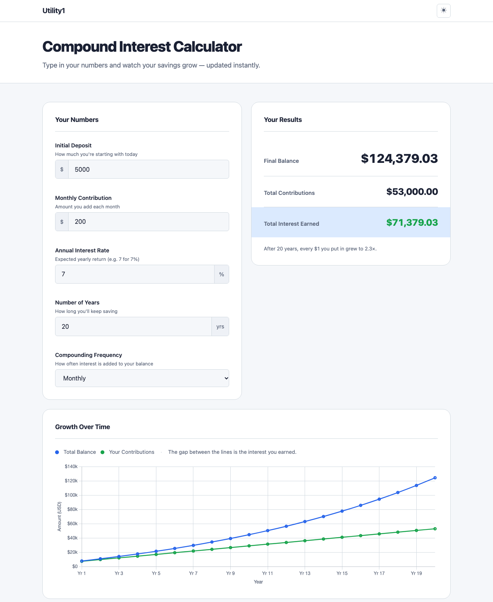
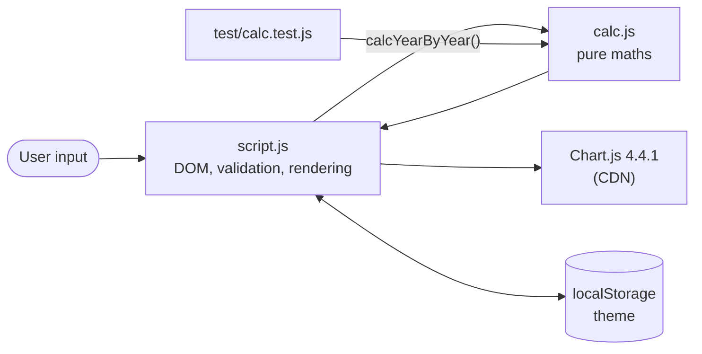

# Utility1 — Finance Calculators

Fast, ad-free finance calculators in plain HTML, CSS and JavaScript. It starts with a compound interest calculator that charts your balance year by year. There is no framework, no build step and no analytics.

**Live demo:** https://thealihassan.github.io/Utility1/



## The problem

Most online calculators bury the answer under ads and sign-ups. This one gives the answer and the chart immediately, and shows how the number is built: how much you put in, how much was interest, and how the gap grows over time.

## Features

- Live results while you type (input is debounced by 200 ms).
- Inputs: initial deposit, monthly contribution, annual rate, years, and compounding (monthly, quarterly or annual).
- Results: final balance, total contributions, total interest, and a plain-English summary line.
- A year-by-year line chart of balance versus contributions, so the interest is the visible gap.
- Inline validation with clear error messages.
- Light and dark themes: follows the system setting, with a manual toggle remembered in `localStorage`.
- A worked example and a short explainer of compound interest below the calculator.

## Tech stack

HTML5, CSS3 and vanilla JavaScript. [Chart.js](https://www.chartjs.org/) 4.4.1 for the chart, loaded from the jsDelivr CDN and pinned to that version. Tests use Node's built-in test runner (no dependencies), and CI runs on GitHub Actions.

## How it fits together



The maths lives in `calc.js` with no access to the page, so the same file runs in the browser and under Node for testing.

## Run it

```bash
git clone https://github.com/theAliHassan/Utility1.git
cd Utility1
python3 -m http.server 8000   # then open http://localhost:8000
node --test                   # optional: run the tests (Node 18 or newer)
```

You can also just open `index.html` in a browser. The chart needs an internet connection to load Chart.js from the CDN.

## Notes and trade-offs

- **Contribution timing.** Contributions are added at the end of each compounding period. With annual compounding, the twelve monthly payments are added together at year end, which understates the result compared with true monthly deposits. For $5,000 plus $200 a month at 7% over 20 years, the calculator gives $124,379 (monthly), $123,108 (quarterly) and $117,738 (annual).
- **Simple model.** The rate is a fixed nominal annual rate. There is no inflation, tax or fees, and this is an educational tool, not financial advice.
- **Tested maths.** The tests compare the calculator with the closed-form compound interest formula and check that the explainer's worked example matches the calculator's output.
- **CDN dependency.** Keeping the project free of build tooling means the chart depends on a CDN being reachable.
- **Accessibility.** The markup uses labels, landmarks and visible focus states, but I haven't run a formal accessibility audit.

## What I'd do next

The planned calculators, roughly in order: simple interest, loan / EMI, savings goal, retirement (FIRE), and debt payoff (avalanche vs. snowball). The favicon and share-card image are still placeholders and need real assets.

## Contributing

Suggestions are welcome via GitHub Issues.

## License

MIT — see [LICENSE](LICENSE).
